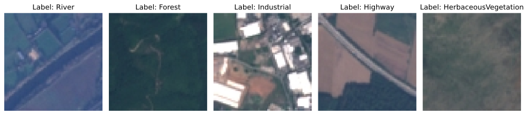
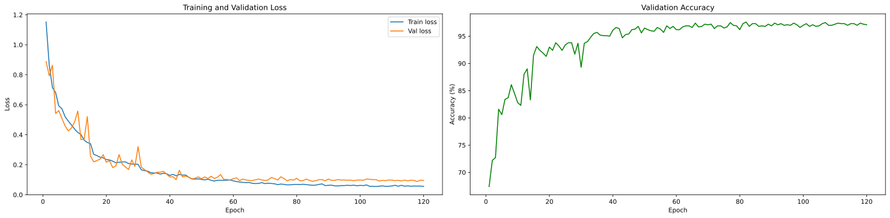
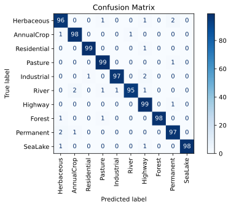
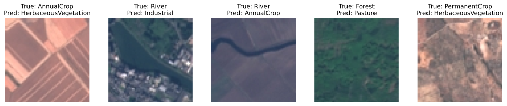

# Satellite Image Classification with a CNN (EuroSAT)

For my first university project I have trained a convolutional neural network from scratch, to classifies 64×64 satellite images into 10 different classes. The repo also contains a small web app which puts the model into deployment.

| | |
|---|---|
| **Validation accuracy** | 97.6 % (best epoch 82 of 120) |
| **Test accuracy** | 97 % (scored on the course challenge server) |
| **Parameters** | about 1.7 M (6.9 MB weights file) |
| **Data** | 10,000 images, 90/10 stratified train/validation split, seed 42 |

The model was also the most accurate with respect to compactness and to deployment speed among 500 submissions in the university course challenge.

## Task

Classification on a 10,000-image subset of EuroSat (Satellite images, 64×64 RGB), provided for the course *Programming in Python II* at JKU Linz. The ten classes are `AnnualCrop`, `Forest`, `HerbaceousVegetation`, `Highway`, `Industrial`, `Pasture`, `PermanentCrop`, `Residential`, `River` and `SeaLake`.



## Preprocessing
- Split: The 90/10 train, test split was stratified to maintain label distributions. Fixed seed for reproducibility.
- Normalization: per-channel mean and standard deviation were computed on the training set only. This is especially important to avoid data leakage into the test set.
- Augmentation: random flips and rotations were only applied on the training set. These operations are label preserving, since satellite images have no fixed orientation.
- EDA: I checked pixel and brightness distributions per class before training. Figured out: Color -and brightness transformations of images would cause a distortion of important features.

## Model

Five convolutional layers, each followed by batch normalization and ReLU as non-linearity. Inbetween three max-pooling steps. Global average pooling was applied before the linear classifier head in order to reduce the number of weights..

```
Conv(3→64) → Conv(64→64) → MaxPool → Conv(64→128) → MaxPool →
Conv(128→256) → MaxPool → Conv(256→512) → GlobalAvgPool →
Linear(512→256) → ReLU → Dropout(0.5) → Linear(256→10)
```
## Design decisions

**3×3 convolutions with padding 1.** Small kernels run on top of each other see a large area with few weights (two 3×3 layers cover the same area as one 5×5 layer, with fewer parameters). If the kernels are chosen too small (2x2,1x1), they will struggle to capture any texture over multiple pixels. Padding keeps the image size unchanged by the kernels.

**Batch normalization + ReLU after every convolution.** Batch normalization not only allows a faster learning rate by to stabilizing distributions between layers but also acts as a form of regularization.  ReLU then adds the necessary non-linearity.

**Pooling.** Each max-pool halves the resolution by choosing only the maximum value of a 2x2 grid moved over every feature map. For my network this means: less computation due to fewer parameter, reduced memorization (overfitting) and highlighted important features such as edges.

**Starting 64-channel layers.** The first block is applied to the full 64×64 resolution. The two layers there extract more low-level features like edges and color transitions, before the image is downsampled and information is lost.

**Channels doubling (64 → 128 → 256 → 512).** Each pooling step halves the height and width, so the number of channels increases to keep the capacity per stage up. Deeper features are more abstract and more varied, and they need more channels to describe them.

**Global average pooling vs. flatten.** After the last convolution the feature map is 8×8×512. Flattening it would give a 32,768-dimensional vector, and the first linear layer alone would need about 8.4 million weights (from older tested model versions). Averaging each channel gives a 512-dimensional vector and only about 131,000 weights, 64 times fewer. This keeps the whole model at about 1.7 million parameters, lowers the risk of overfitting and makes it easy to deploy.

**Dropout 0.5 in the classifier head.** A regularizer for the fully connected part, which is where overfitting is most likely.

**Design evolution.** An earlier variant with three convolution blocks plateaued at about 93% validation accuracy. The final architecture is deeper and uses global average pooling, together with data augmentation and a learning-rate schedule (halved every 15 epochs), and reaches 97.6%.

## Training

- Loss and optimizer: cross-entropy, Adam with learning rate 1e-3
- Learning-rate schedule: StepLR, halved every 15 epochs
- Batch size 64, 120 epochs, the checkpoint with the best validation accuracy is kept



## Evaluation



Validation images the model misclassified:




## Repository

```
eurosat_cnn.ipynb      data handling, EDA, model, training, evaluation, test predictions
model.py               model definition, label map, normalization constants
app.py                 Shiny for Python web app for inference
assets/weights/        best_model.pth (trained weights)
docs/                  figures used in this README
```

## Run it

```bash
pip install -r requirements.txt

# web app (weights are included, no data needed)
shiny run app.py
```

To re-run the notebook, place the data next to it as `data/<ClassName>/*.jpg` (labelled images) and `public_test_data/*.jpg` (unlabelled test images). The data is not part of this repository.

The web app takes an uploaded image, resizes it to 64×64, normalizes it with the training statistics and shows the predicted class together with all ten class probabilities.
